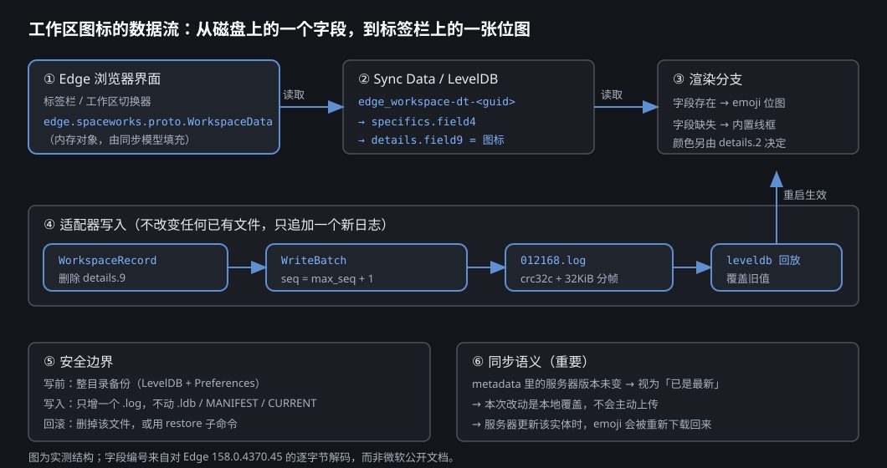

# Edge 工作区图标适配器

把新版 Edge 工作区的彩色 Emoji 图标，改回旧版的**蓝色叠层线框图标**。复用 Edge 自带图标资源，使用 Python 标准库实现。


> 图中两张都是 Edge 自己渲染并缓存的真实图标：左边是 Emoji（📁），右边是内置线框。线框颜色随工作区颜色变化。

---

## 它解决什么问题

从 Edge 150 开始，新建工作区会自动分配一个彩色 Emoji；而旧版工作区用的是低调的蓝色线框叠层图标。
Edge 界面未提供取消 Emoji 的入口。本工具直接改工作区本地配置里的图标字段，
让 Edge 走它自己的回退分支，显示内置线框图标。

改动特点：

- 一次只改你指定的那个工作区，其他工作区不受影响。
- 改之前自动完整备份，随时可以还原。
- Edge 开着的时候可以扫描和预览；**真正写入时必须先退出 Edge**。
- 重启 Edge 后生效；实测有效。

---

## 快速开始

前置条件：Windows、Edge 150+、Python 3.10+，仅用标准库。

在项目目录打开 PowerShell：

```powershell
# 1. 看看现在有哪些工作区、各自用的什么图标（Edge 可以开着）
python adapter\cli.py scan

# 2. 预览要改什么，不写任何文件
python adapter\cli.py preview --workspace "<工作区名称>" --icon default

# 3. 完全退出 Edge（包括托盘图标），然后应用
python adapter\cli.py apply --workspace "<工作区名称>" --icon default

# 4. 重新打开 Edge，验收
python adapter\cli.py verify --workspace "<工作区名称>"
```

`scan` 输出里 `icon` 一列显示 `📁` 表示当前是 Emoji，显示 `DEFAULT` 表示已经是线框图标。
如果 `layout` 一列显示 `UNKNOWN`，说明你的 Edge 版本没验证过，工具会拒绝写入——见下面的 FAQ。

---

## 常用操作

| 想做什么 | 命令 |
|---|---|
| 把图标改回某个 Emoji | `python adapter\cli.py apply --workspace "<名称>" --icon "📁"` |
| 用别的 Profile | 加 `--profile-dir "%LOCALAPPDATA%\Microsoft\Edge\User Data\Profile 1"` |
| 看有哪些备份 | `python adapter\cli.py backups` |
| 还原到改动之前 | `python adapter\cli.py restore --backup "<备份目录>"`（需先退出 Edge） |
| 一次处理多个工作区 | 对每个名称分别执行 `preview` 再执行 `apply` |
| 检查改动是否还在 | `python adapter\cli.py verify --workspace "<名称>"` |

备份默认放在 `%LOCALAPPDATA%\edge-workspace-adapter\backups\`，与仓库分离。

---

## 常见问题

**Q：影响范围**
一次只改一个工作区记录，其余字段原样保留。验收时可以用 `scan` 前后对比。

**Q：会被 Edge 同步覆盖吗？**
本次改动保留在本机，重启 Edge 后实测仍保持线框。
服务器上的该工作区在别的设备改动过、或重新登录触发全量下载时，Emoji 会随同步回到本地。
让改动持久化到云端的三种策略见 [agent.md](agent.md) 第 2 节。

**Q：Edge 升级后还能用吗？**
先跑一次 `scan`。`layout` 显示 `known` 或 `shape-compatible` 时工具执行写入；显示 `UNKNOWN` 时工具停止，
等待布局记录更新。新版本适配方法见 [agent.md](agent.md) 第 3 节。

**Q：改错了 / 想恢复原来的 Emoji 怎么办？**
两种方式：用 `restore --backup <备份目录>` 整目录还原；或者用 `--icon "📁"` 把 Emoji 写回去。

**Q：需要管理员权限、要装浏览器扩展吗？**
都不需要。只是一个 Python 命令行工具。

**Q：图标缓存文件的作用**
`JumpListIconsRecentWorkspacesV2` 里的 `.ico` 只是任务栏图标的渲染结果，删了 Edge 会按同一配置重新生成。
真正决定用 Emoji 还是线框的是一个配置字段。

---

## 工作原理

工作区配置保存在 Edge 的同步数据库中：

```
%LOCALAPPDATA%\Microsoft\Edge\User Data\<profile>\Sync Data\LevelDB
└─ edge_workspace-dt-<工作区ID>  →  details.field9 = "<emoji 字符串>"
```

图标配置的读取链条：

1. `details.field9` 存有 Emoji 字符串，Edge 渲染 Emoji 图标。
2. 删除 `details.field9`，Edge 读取内置线框资源，并按 `details.field2` 着色。
3. 图标资源由 Edge 自带，适配器只修改字段内容。


写入与回滚链条：



1. `scan` 把数据库复制到临时目录，全程读取副本。
2. `apply` 在 Edge 退出后创建备份，并向 LevelDB 追加一个新 `.log`。
3. Edge 重启，leveldb 回放日志里的 WriteBatch，新值覆盖旧值。
4. 同步模型读取新值，界面显示线框图标。
5. `restore` 恢复备份目录，完成回滚。

---

## 实测结果

在 Edge 158 上验证：17 个工作区中 1 个带 Emoji；改完后该工作区变成 `DEFAULT`，
其余 16 个未变；关闭并重启 Edge 后仍然保持。两次快照的差异只有一行：

```
~ <workspace name>: emoji '📁' -> None
```

完整实验记录与逆向证据见 [research/experiment-results.md](research/experiment-results.md)。

---

## 进阶阅读

- [agent.md](agent.md) — 详细运行方式、定制方法、同步策略、版本兼容策略
- [research/storage-analysis.md](research/storage-analysis.md) — 哪个是配置、哪个只是缓存
- [research/workspace-schema.md](research/workspace-schema.md) — 字段结构
- [research/default-icon-analysis.md](research/default-icon-analysis.md) — 旧版线框图标能否恢复
