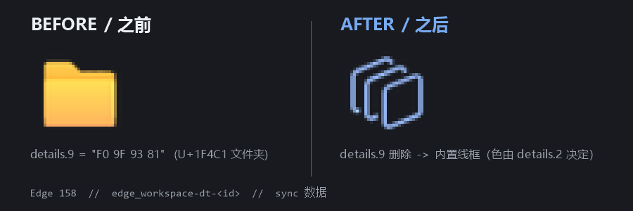
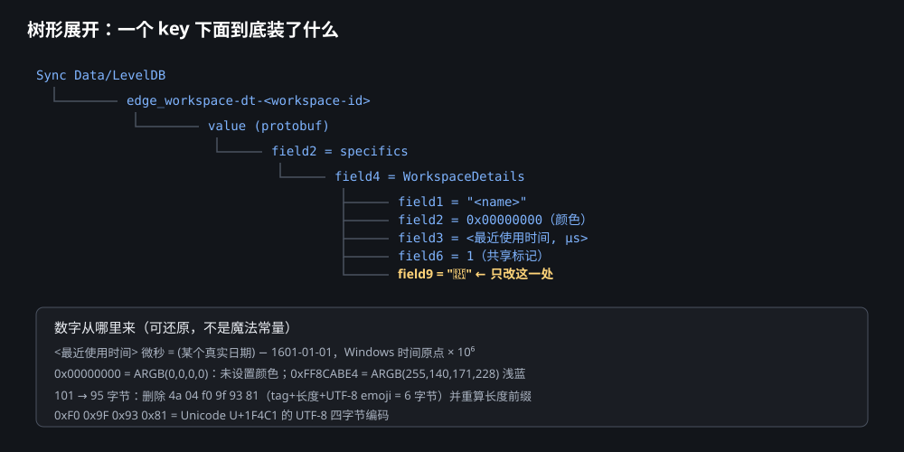

# Edge 工作区图标适配器

把指定工作区的图标从「新版 emoji」改回「旧版内置线框」，可预览、可备份、可回滚，并给出可复验的证据。



> 两张图标都是 Edge 158 自己缓存并渲染的真实位图，不是示意图：左侧为 `📁`，右侧为线框图标（示例色为浅蓝；实际颜色由 `details.2` 决定）。

**运行方式、同步权威性、版本兼容策略** 见 [agent.md](agent.md)。

---

## 一句话结论

图标配置既不在 `Preferences`，也不在 `WorkspacesCache`（该目录在 Edge 158 里不存在），而在
`%LOCALAPPDATA%\Microsoft\Edge\User Data\<profile>\Sync Data\LevelDB` 的一个 protobuf 字段里：
`edge_workspace-dt-<workspace_id>` → `specifics.field4` → `details.field9`。
**删掉 `field9`，Edge 就渲染内置线框；字段存在，就渲染 emoji。** 已在实测 Profile 上验证。

---

## 需求里的三个问题，逐个回答

| 问题 | 答案 | 证据级别 |
|---|---|---|
| 新版 Workspaces 的真实配置在哪里？`WorkspacesCache` 是缓存吗？ | 在 `Sync Data\LevelDB`，key 形如 `edge_workspace-dt-<GUID>`；`WorkspacesCache` 不存在（`Workspaces\` 只有 `Logs`、`Collaborators`）。`JumpListIconsRecentWorkspacesV2\` 只是任务栏位图缓存，不是配置源。 | 【事实】全盘搜索 + 逐字节解码 |
| 图标是字符串、Unicode 字符、资源 ID 还是其他类型？空值触发回退吗？ | 是 **protobuf 的 UTF-8 string 字段** `details.field9`；`📁` 为 `F0 9F 93 81`。不是资源 ID；颜色另在 `details.field2`（uint32 ARGB）。字段**缺失**才回退；空串变体本机无样本。 | 【事实】17 个工作区记录 |
| 改完后 Edge 会不会从同步数据重新覆盖？ | 有条件会。metadata 的服务器版本未变，改动不会主动上传；重启后实测未被覆盖。若服务器版本前进（其他设备改动或全量下载），emoji 可能被重新下载。解决策略见 `agent.md` 第 2 节。 | 【事实】重启后复扫 【推断】同步语义 |

---

## 树形展开：把记录拆到初等概念

```
Sync Data/LevelDB                       ← Chromium 的键值数据库
└─ edge_workspace-dt-<workspace-id>     ← key：工作区或标签页
   └─ value (protobuf)
      ├─ field1 = 1                     ← 固定标记
      ├─ field2 = specifics
      │  ├─ field1 = "<workspace-id>"   ← 与 key 后缀一致
      │  ├─ field2 = 创建时间（µs）
      │  ├─ field3 = 修改时间（µs）
      │  └─ field4 = WorkspaceDetails   ← 工作区用 field4；标签页用 field5
      │     ├─ field1 = "<name>"
      │     ├─ field2 = ARGB 颜色；0 表示未设置
      │     ├─ field3 = 最近使用时间（µs）
      │     ├─ field6 = 共享标记
      │     └─ field9 = "<emoji>"       ← 【图标字段】
      └─ field3 = {field1: 0}           ← 固定标记
```



数字可还原：`101 → 95` 字节 = 删除 `4a 04 f0 9f 93 81`（6 字节）并重算两级长度前缀；
`f0 9f 93 81` 是 U+1F4C1 的 UTF-8 编码；时间戳是 Windows 原点（1601-01-01）起的微秒数。
**没有魔法常量。**

---

## 数据流：一次修改经过了什么


1. `scan` 先把 LevelDB 文件复制到临时目录再读，不打开正在使用的数据库。
2. `apply` 在 Edge 退出后，把同一 key 的新 value 打成 `WriteBatch`（`seq = max_seq + 1`），
   写入**新的** `.log`（crc32c + 32 KiB 分帧），不改 `.ldb` / `MANIFEST` / `CURRENT`。
3. leveldb 打开时回放日志，新序列号覆盖旧值。
4. Edge 读取该实体，`field9` 缺失 → 内置线框。
5. 回滚：删掉新增日志，或执行 `restore`。

**为什么不用更简单的做法？**

| 做法 | 为什么不行 |
|---|---|
| 改 `Preferences` / `edge://flags` | 字段不在其中；全盘搜索只命中 Sync Data、图标缓存和会话文件。【事实】 |
| 删 `JumpListIconsRecentWorkspacesV2\*.ico` | 那是渲染结果，删了会按同一配置重新生成。【事实】 |
| 直接改 `.ldb` 字节 | 长度变化会破坏 SSTable 块偏移与 restart 数组；只能追加日志。【推断+实测】 |
| UI 逐个改图标 | 可生效但不便批量复现，且新版 UI 可能不提供“取消 emoji”入口。【推断】 |
| 改服务端 | 无官方接口，且跨设备影响他人；本地覆盖更安全。 |

---

## 使用

Python 3.10+，仅标准库（见 `requirements.txt`）。在项目目录执行：

```powershell
# 1) 扫描（Edge 开着也能跑）
python adapter\cli.py scan

# 2) 预览（不写文件；同时会做布局兼容性检查）
python adapter\cli.py preview --workspace "<工作区名称>" --icon default

# 3) 应用（必须先关闭所有 msedge.exe；自动备份）
python adapter\cli.py apply --workspace "<工作区名称>" --icon default

# 4) 重启 Edge 后验收
python adapter\cli.py verify --workspace "<工作区名称>"

# 5) 回滚
python adapter\cli.py backups
python adapter\cli.py restore --backup "<备份目录>"
```

备份默认写到 `%LOCALAPPDATA%\edge-workspace-adapter\backups`，**不在仓库里**。
`--icon` 也接受任意 emoji；`--profile-dir` 可指定非默认 Profile。
`--allow-unknown` / `--force` 仅用于诊断，详见 `agent.md`。

---

## 实测效果

| 检查项 | 结果 |
|---|---|
| 修改前 | 17 个工作区，其中 1 个带 emoji |
| 修改后（未重启，立刻复扫） | 新值已被读出：`details.field9` 不存在 |
| 修改后（关闭并重启 Edge） | 仍为 `DEFAULT`；其余 16 个工作区字段未变 |
| 同步影响 | 服务器版本未前进，未上传；重启后未被写回 |
| 备份 | 整目录 LevelDB + Preferences，位于本机应用数据目录 |
| 副本对照实验 | 未修改副本保留 17 个工作区；异常启动参数导致清空，与本写入机制无关 |

两次快照的机器可读差异只有一行：

```
~ <workspace name>: emoji '📁' -> None
```

完整实验记录见 [research/experiment-results.md](research/experiment-results.md)。

---

## 自检五问

1. **悬空名词？** 无。LevelDB、WriteBatch、protobuf、ARGB、Windows epoch 均在文中或 `research/` 定义。
2. **数字可还原？** 是。`101→95`、emoji 四字节、ARGB、时间戳都有换算过程。
3. **换法对比？** 上表列了 5 种更简单的做法及失败原因。
4. **层级一致？** 树形展开说“结构”，数据流说“过程”，没有混用。
5. **可证伪？** 每条结论都能用 `scan` / `verify` / 备份回滚复验；同步覆盖预测可在另一台设备复测。

## 已知边界

- 【事实】仅在 Edge 158.0.4370.45 的实测 Profile 上验证；其他版本先跑 `scan` 看 `layout`。
- 【事实】写入要求 Edge 完全退出；`--force` 仅供副本实验。
- 【推断】服务器可能恢复 emoji；持久化策略见 `agent.md` 第 2 节。
- 【事实】未知布局会拒绝写入；兼容性维护策略见 `agent.md` 第 3 节。

---

## 上传到一个新的远程仓库

本地仓库已初始化为 `main` 分支，按模块拆分为多次提交，工作树干净、无真实 Profile 数据。

1. 在 GitHub（或你的托管平台）新建一个**空仓库**，建议先设为 private，例如 `edge-workspace-adapter`。
2. 添加远端并推送：

```powershell
git remote add origin https://github.com/<你的账号>/edge-workspace-adapter.git
git push -u origin main
```

如果本机没有可用的 GitHub 凭据：安装 GitHub CLI 后执行 `gh auth login`，再用
`gh repo create edge-workspace-adapter --private --source=. --remote=origin --push`；
或者直接在网页创建空仓库后走上面的 HTTPS 推送。
